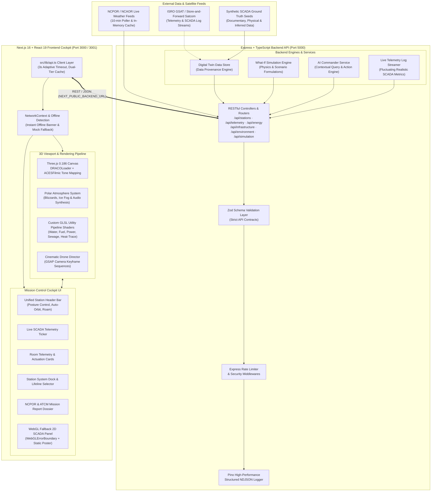

# ❄️ Himdrishti: Digital Twin for India's Antarctic Research Stations

[](https://nextjs.org/)
[](https://react.dev/)
[](https://threejs.org/)
[](https://expressjs.com/)
[](https://www.typescriptlang.org/)
[](https://zod.dev/)
[](https://jestjs.io/)
[](https://sih.gov.in/)

> **Smart India Hackathon (SIH 2026) · Problem Statement ID: `26060`**  
> **Organization:** National Centre for Polar and Ocean Research (NCPOR), Ministry of Earth Sciences (MoES), Government of India.  
> **Title:** *Digital Twin Framework for Antarctic Research Stations (Bharati and Maitri) Integrating Infrastructure, Energy, Logistics, and Environmental Monitoring for Efficient Remote Management.*

---

## 📑 Table of Contents

1. [Executive Summary](#-executive-summary)
2. [Key Capabilities & Innovations](#-key-capabilities--innovations)
3. [System Architecture](#-system-architecture)
4. [Tech Stack](#-tech-stack)
5. [Quick Start & Demo Guide](#-quick-start--demo-guide)
6. [Frontend Bundler Flag (`--webpack`)](#-frontend-bundler-flag---webpack)
7. [Environment Configuration](#-environment-configuration)
8. [Available Scripts](#-available-scripts)
9. [Automated Testing](#-automated-testing)
10. [Repository Structure](#-repository-structure)
11. [Offline Mode & WebGL Fallback](#-offline-mode--webgl-fallback)
12. [Documentation & Deep Dives](#-documentation--deep-dives)
13. [Contributing](#-contributing)
14. [Team Intell-Alpha & Credits](#-team-intell-alpha--credits)
15. [License](#-license)

---

## 🌐 Executive Summary

Operating permanent research stations in Antarctica—**Bharati** (Larsemann Hills, $69^\circ 24'\text{S}$) and **Maitri** (Schirmacher Oasis, $70^\circ 46'\text{S}$)—is one of the most logistically demanding operational challenges on Earth. Station crews battle $-40^\circ\text{C}$ katabatic blizzards, sub-polar isolation, and strictly constrained satellite bandwidth to maintain uninterrupted power generation, fuel reserves, water desalination, and life support.

**Himdrishti** is an aerospace-grade, web-first Digital Twin and Remote Mission Control Cockpit. It bridges the $12,000\text{ km}$ divide between NCPOR Headquarters in Goa and Antarctica by synthesizing:

1. **Photogrammetric & CAD 3D Digital Twins** with millimeter-accurate building assemblies, room-level telemetry, and x-ray utility pipeline cutaways.
2. **Real-time Multi-Utility Lifeline Monitoring** (Hydronic Heating, Potable Water, Sewage Treatment, Fuel Distribution, and Microgrid Power).
3. **What-If Crisis Simulation Engine** for rehearsing extreme weather blizzards, generator trips, supply chain delays, and satellite comms blackouts.
4. **HIMADRI AI Station Commander** (Natural language operational copilot with bi-directional 3D scene actuation).
5. **Fail-Safe Offline Mode & WebGL Fallback** ensuring zero-crash availability during Antarctic network dropouts or on low-power mobile hardware.

---

## ⚡ Key Capabilities & Innovations

| Pillar | Capability | Description | Status |
| :--- | :--- | :--- | :--- |
| **3D Spatial Twins** | **Maitri & Bharati BIM Twins** | High-performance Three.js scenes featuring DRACO-compressed GLTF assets, PBR materials, ACESFilmic tone mapping, and room registry locks for all 16 station modules. | ✅ Fully Operational |
| **Lifeline Shaders** | **Utility Pipeline Matrices** | Custom GLSL pulse shaders visualizing 5 physical lifeline loops (Freshwater, Riello Hydronic Heating, Fuel, Sewage, Microgrid Power). | ✅ Fully Operational |
| **Crisis Simulator** | **What-If Scenario Sandbox** | 5 dynamic scenarios calculating baseline vs. projected delta impacts across fuel autonomy, battery life, indoor temperatures, and safety posture. | ✅ Fully Operational |
| **Copilot** | **HIMADRI AI Commander** | Natural language query engine capable of synthesizing telemetry answers and triggering physical 3D scene reactions (camera fly-tos, blizzards). | ✅ Fully Operational |
| **Atmosphere** | **Katabatic Blizzard Engine** | Procedural snowfall particle system, dynamic ice fog, howling katabatic wind audio engine, and solar lighting transitions. | ✅ Fully Operational |
| **Resilience** | **Bulletproof Offline Cache** | Dual-tier in-memory + `localStorage` caching with seamless network drop detection and ambient notification banner. | ✅ Fully Operational |
| **Hardware Fallback** | **2D SCADA WebGL Fallback** | Automatic degradation to high-resolution photographic SCADA HUD when WebGL is unavailable or GPU context is lost. | ✅ Fully Operational |
| **Compliance** | **ATCM Mission Dossier** | Automated readiness inspector generating Antarctic Treaty Consultative Meeting (ATCM) and NCPOR operational dossiers. | ✅ Fully Operational |

---

## 🏛️ System Architecture

Himdrishti follows a resilient decoupled architecture engineered for mission-critical reliability under intermittent polar satellite connectivity:



---

## 🛠️ Tech Stack

### Frontend Cockpit (Root Package)
- **Framework:** [Next.js 16.3.6](https://nextjs.org/) (App Router, Server Components & Client Hooks)
- **Runtime & UI:** [React 19.2.8](https://react.dev/), React DOM 19.2.8
- **3D Spatial Graphics:** [Three.js 0.186.1](https://threejs.org/), `@react-three/fiber 9.8.1`, `@react-three/drei 10.7.9`, DRACO 3D Geometry Compression
- **Motion & Cinematic Choreography:** [GSAP 3.15.0](https://greensock.com/), `@gsap/react 2.1.2`, [Framer Motion 13.4.4](https://www.framer.com/motion/)
- **Styling & Tokens:** [Tailwind CSS 4](https://tailwindcss.com/), `@tailwindcss/postcss`, Vanilla CSS Design Tokens, Glassmorphism
- **Iconography:** [Phosphor Icons React 2.1.10](https://phosphoricons.com/) (`@phosphor-icons/react`)
- **Audio Engine:** Custom HTML5 Web Audio API Polar Synthesizer (Katabatic wind, UI clicks, blizzard howling)

### Backend API & Simulation Engine (`backend/`)
- **Server Framework:** [Express 4.21.2](https://expressjs.com/) (Node.js 20.x LTS)
- **Language:** [TypeScript 5.7.3](https://www.typescriptlang.org/) (Strict Mode)
- **Schema Validation & Contract Safety:** [Zod 3.25.76](https://zod.dev/)
- **Structured Logging:** [Pino 10.4.0](https://getpino.io/), `pino-http 11.0.0`, `pino-pretty 13.2.0`
- **Security & Reliability:** `cors 2.8.5`, `express-rate-limit 8.7.1`, `dotenv 16.4.7`
- **Testing Suite:** [Jest 30.5.2](https://jestjs.io/), [Supertest 7.3.1](https://github.com/ladjs/supertest), `ts-jest 29.4.15`
- **Execution & Hot Reloading:** `ts-node-dev 2.0.0`

---

## 🚀 Quick Start & Demo Guide

### Prerequisites
- **Node.js:** `v20.x` LTS recommended (check with `node -v`). If using nvm, run `nvm use`.
- **npm:** `v10.x` or higher (bundled with Node 20).
- **Browser:** Any modern browser (Chrome, Edge, Firefox, Safari). WebGL is recommended for the 3D twin, but automatic 2D SCADA fallback is included.

---

### Step 1: Clone Repository
```bash
git clone https://github.com/Intell-Alpha/Antarctica_Digital_twin.git
cd Antarctica_Digital_twin
```

---

### Step 2: Spin Up the Backend API (`port 5000`)

From the repository root, install dependencies and launch the backend development server:

```bash
# Install backend dependencies
npm --prefix backend ci

# Copy environment variables (Windows PowerShell: Copy-Item backend/.env.example backend/.env)
cp backend/.env.example backend/.env

# Start the Express API in dev mode with auto-reload
npm run backend:dev
```

Verify backend health in your terminal or browser:
```bash
curl http://localhost:5000/health
# Response: {"status":"ONLINE","timestamp":"...","uptime":...}
```

---

### Step 3: Spin Up the Frontend Cockpit (`port 3000` or `3001`)

Open a second terminal at the repository root:

```bash
# Install frontend dependencies
npm ci

# Copy frontend environment variables (Windows PowerShell: Copy-Item .env.example .env.local)
cp .env.example .env.local

# Launch Next.js dev server with webpack
npm run dev
```

> **Note on Port:** If port `3000` is already occupied, start on port `3001` using:  
> `npm run dev -- --port 3001`

Open your browser to: **<http://localhost:3000>** (or **<http://localhost:3001>**).

---

### 🌟 Key Interactive Demo Flows for Evaluators

1. **Spatial Digital Twin Cockpit (`/twin` & `/twin/bharati`)**
   - Click **"Full-Screen Cockpit"** or navigate to `/twin` (Maitri Station) and `/twin/bharati` (Bharati Station).
   - Use **OrbitControls** (left-click drag to rotate, right-click drag to pan, wheel to zoom).
   - Use the **Polar Virtual Joystick** or `W`, `A`, `S`, `D` keys for free-roam navigation around the station.

2. **Lifeline Utility Matrix**
   - Click the **"Lifelines"** button in the bottom dock.
   - Cycle through **Potable Water**, **Fuel Lines**, **Power Grid**, **Sewage Treatment**, and **Radiant Heat-Tracing** to witness dynamic animated GLSL pipeline pulses.

3. **Room-Level Telemetry & Person-View Lock**
   - Click **"Facilities"** in the bottom dock.
   - Select any station room (e.g., *IMD Meteorology Lab*, *Boiler Room*, or *Operations Hub*) to smoothly fly the camera inside and inspect live temperature, pressure, and remote SCADA actuation triggers.

4. **Katabatic Blizzard & Operational Postures**
   - Toggle station operational postures in the top command bar:
     - `NOMINAL` ➔ Standard Antarctic summer/winter operation.
     - `BLIZZARD_LOCKDOWN` ➔ Triggers howling katabatic storm, whiteout blizzard particle engine, and sun dimming.
     - `ENERGY_CONSERVATION` ➔ Lowers non-critical HVAC and sheds secondary loads.
     - `BLACK_START` ➔ Emergency microgrid cold restart simulation.

5. **HIMADRI AI Station Commander**
   - Click the **"AI Commander"** terminal button in the top bar.
   - Ask natural language operational questions:
     - *"What is our current fuel autonomy in days?"*
     - *"Inspect the main powerhouse and fly inside."*
     - *"Simulate a katabatic blizzard lockdown."*

6. **What-If Crisis Sandbox (`/dashboard/simulations`)**
   - Test crisis contingencies including **Katabatic Blizzard**, **Primary Generator Failure**, **Supply Vessel Delay**, and **Satellite Comms Outage**.
   - Compare baseline telemetry against calculated crisis impact deltas.

7. **Resilience Testing (Offline Mode & WebGL Fallback)**
   - **Offline Mode:** Disconnect your Wi-Fi or set Network to *Offline* in DevTools. The frontend instantly displays the `"OFFLINE MODE — SERVING CACHED TELEMETRY"` amber banner with zero glitches.
   - **WebGL Fallback:** Append `?fallback=1` to any twin URL (e.g. `/twin?fallback=1`). Experience the high-resolution 2D photographic SCADA HUD with technical diagnostics and engine re-initialization.

---

## ⚙️ Frontend Bundler Flag (`--webpack`)

Next.js 16 introduces Turbopack as the default development bundler. In this repository, the dev script is configured with **`--webpack`**:

```json
"scripts": {
  "dev": "next dev --webpack"
}
```

### Why `--webpack`?
- **Three.js Shader Stability:** Webpack ensures reliable compilation of customized Three.js onBeforeCompile GLSL injection hooks and PMREM cubemap generators.
- **Font & CSS Module Hot Reloading:** Workaround for dev-mode font sub-setting synchronization under early Next.js 16 bundlers.
- **Production Parity:** Next.js production builds (`next build`) use the standard optimized compiler with zero configuration required.

> **Passing Custom Port Arguments:**  
> When running `npm run dev`, pass extra arguments after `--`:  
> `npm run dev -- --port 3001`

---

## 🔐 Environment Configuration

Environment files are templated via committed `.example` files. Create your local secrets by copying them; real `.env` files are ignored by git.

| Template File | Target Location | Description |
| :--- | :--- | :--- |
| [`.env.example`](.env.example) | `.env.local` (Root) | Public frontend configuration (API endpoints) |
| [`backend/.env.example`](backend/.env.example) | `backend/.env` | Express server port, CORS whitelist, and logging |

### Frontend Variables (`.env.local`)
| Variable | Default Value | Description |
| :--- | :--- | :--- |
| `NEXT_PUBLIC_BACKEND_URL` | `http://localhost:5000` | Target URL of the Express backend API. |

### Backend Variables (`backend/.env`)
| Variable | Default Value | Description |
| :--- | :--- | :--- |
| `PORT` | `5000` | Port on which the Express server listens. |
| `NODE_ENV` | `development` | Runtime environment (`development`, `production`, `test`). |
| `CORS_ORIGIN` | `http://localhost:3000` | Whitelisted frontend origin for CORS policies. |
| `NCPOR_BASE_URL` | `https://ncpor.example.gov.in/api` | Base URL for remote NCPOR data synchronization. |
| `POLLER_ENABLED` | `true` | Background weather sync toggle. |

---

## 📜 Available Scripts

| Scope | Command | Description |
| :--- | :--- | :--- |
| **Root** | `npm run dev` | Launches the Next.js dev server with Webpack on port `3000`. |
| **Root** | `npm run build` | Compiles and optimizes the Next.js production build. |
| **Root** | `npm run start` | Serves the optimized Next.js production build. |
| **Root** | `npm run lint` | Runs ESLint 9 across all frontend source files. |
| **Root** | `npm run backend:dev` | Runs `npm run dev` in `backend/` via `ts-node-dev`. |
| **Root** | `npm run backend:build` | Compiles backend TypeScript to `backend/dist`. |
| **Root** | `npm run backend:start` | Executes the compiled backend server from `backend/dist`. |
| **Root** | `npm run backend:test` | Executes the Jest test suite across backend services. |
| **Backend** | `npm test` | Runs Jest smoke and simulation unit tests directly. |

---

## 🧪 Automated Testing

The backend includes a comprehensive automated test suite powered by **Jest**, **Supertest**, and **ts-jest**.

Run the test suite directly from the repository root:
```bash
npm run backend:test
```

### Test Coverage Highlights:
- **Health & Readiness Check:** Validates `GET /health` returns status `ONLINE` with valid uptime and timestamp.
- **Station Telemetry Smoke Tests:** Verifies telemetry endpoints (`/api/telemetry`, `/api/stations`) respond within latency SLAs and output valid Zod-compliant JSON payloads.
- **Simulation Formula Tests:** Validates mathematical consistency of what-if scenario equations across all 5 crisis modes.

---

## 📂 Repository Structure

```text
Antarctica_Digital_twin/
├── src/                               # Next.js 16 App Router Frontend
│   ├── app/                           # Route Pages
│   │   ├── layout.tsx                 # Root layout with NetworkProvider
│   │   ├── page.tsx                   # Cinematic Hero Landing Page
│   │   ├── dashboard/                 # SCADA Management Dashboard
│   │   │   ├── alerts/                # Station Alarm Registry & Audit
│   │   │   ├── communications/        # Satcom Link Telemetry
│   │   │   ├── energy/                # Microgrid & CHP Generation
│   │   │   ├── environment/           # Polar Weather & Meteorology
│   │   │   ├── infrastructure/        # Structural Health & MEP Systems
│   │   │   ├── logistics/             # Fuel & Food Inventory Autonomy
│   │   │   └── simulations/           # Interactive What-If Scenario Sandbox
│   │   ├── twin/                      # Maitri 3D Digital Twin Cockpit
│   │   └── twin/bharati/              # Bharati 3D Digital Twin Cockpit
│   ├── components/                    # React UI & 3D Components
│   │   ├── MaitriStationTwin.tsx      # Maitri 3D Three.js Digital Twin
│   │   ├── BharatiStationTwin.tsx     # Bharati 3D Three.js Digital Twin
│   │   ├── WebGLFallback.tsx          # 2D Photographic SCADA Fallback HUD
│   │   ├── WebGLErrorBoundary.tsx     # Three.js Graphics Exception Boundary
│   │   ├── OfflineBanner.tsx          # Real-time Offline Connectivity Banner
│   │   ├── StationAICommander.tsx     # HIMADRI AI Copilot Drawer
│   │   ├── TwinWhatIfSimulator.tsx    # Controlled What-If Simulator Drawer
│   │   ├── CinematicDroneDirector.tsx # 4K GSAP Aerial Drone Director
│   │   ├── PolarAtmosphereSystem.ts   # Blizzard & Particle Fog System
│   │   ├── PolarVirtualJoystick.tsx   # Free-Roam Navigation Controls
│   │   └── MissionReportModal.tsx     # ATCM Readiness Briefing Dossier
│   ├── context/                       # NetworkContext & ThemeContext
│   ├── hooks/                         # useReducedMotion, useNetworkStatus
│   └── lib/                           # api.ts (Dual-tier cache), webglSupport.ts
├── backend/                           # Express + TypeScript API Server
│   ├── src/
│   │   ├── __tests__/                 # Jest & Supertest Integration Suites
│   │   ├── config/                    # Environment & Pino Logger Config
│   │   ├── controllers/               # Station, Telemetry & Simulation Controllers
│   │   ├── routes/                    # API Route Definitions
│   │   ├── services/                  # DigitalTwinEngine, WeatherPoller, Commander
│   │   └── store/                     # Seed Data with Provenance Metadata
│   ├── package.json                   # Backend Dependencies & Scripts
│   └── tsconfig.json                  # TypeScript Compiler Configuration
├── public/                            # Static Assets
│   ├── assets/                        # DRACO-compressed GLB Models & Station Posters
│   ├── backgrounds/                   # Atmospheric Antarctic Visuals
│   └── draco/                         # Google DRACO WebAssembly Decoders
├── .github/                           # CI Workflows, Issue & PR Templates
├── CONTRIBUTING.md                    # Developer Contribution Guide
├── package.json                       # Frontend Manifest & Root Orchestration Scripts
└── README.md                          # Repository Documentation & System Architecture
```

---

## 🛡️ Offline Mode & WebGL Fallback

### 1. Robust Dual-Tier Offline Mode
If polar satellite internet drops during a demo or remote mission monitoring:
- **Instant Failure Bypass:** [`src/lib/api.ts`](src/lib/api.ts) immediately catches network dropouts without waiting for standard browser timeout delays.
- **Dual-Tier State Storage:** Every API response is cached in memory and mirrored to browser `localStorage`.
- **Offline Notification:** An amber HUD banner informs operators that cached state is actively serving all telemetry, preventing blank UI glitches.

### 2. High-Fidelity 2D SCADA WebGL Fallback
If an operator accesses the cockpit from a device without GPU acceleration:
- **Context Loss Recovery:** Detects `webglcontextlost` and unhandled Three.js exceptions gracefully.
- **Photographic Poster View:** Displays full-resolution optical surveillance feeds ([`/assets/maitri_station.jpg`](public/assets/maitri_station.jpg) and [`/assets/bharati_station.jpg`](public/assets/bharati_station.jpg)).
- **Uncompromised Monitoring:** All SCADA dials, facility metrics, posture switches, and AI Commander consoles remain 100% interactive.

---

## 📚 Documentation & Deep Dives

- 📘 [**Backend Architectural Guide**](backend/README.md) — Detailed REST API contracts, Zod schemas, and simulation formulas.
- 📙 [**Bharati Station Integration Guide**](BHARATI_DIGITAL_TWIN_INTEGRATION_GUIDE.md) — 134 modular ISO container coordinate mappings and camera transitions.
- 📗 [**Maitri Station Asset Guide**](maitri_asset_guide.md) — Utility pipeline lifelines, Riello boiler hydronics, and animation clips.
- 📕 [**Remote Management Framework**](DIGITAL_TWIN_REMOTE_MANAGEMENT.md) — Sensor provenance models, ATCM compliance, and vitals bar.
- 📝 [**Contributing Guidelines**](CONTRIBUTING.md) — Branch naming, conventional commits, and pull request workflows.

---

## 🤝 Contributing

Contributions are welcome! Please review [**`CONTRIBUTING.md`**](CONTRIBUTING.md) before submitting a pull request.
1. Fork the project & create your feature branch: `git checkout -b feat/your-feature-name`.
2. Ensure linting and tests pass: `npm run lint` and `npm run backend:test`.
3. Commit with Conventional Commits: `git commit -m "feat: add your feature"`.
4. Open a Pull Request adhering to the repository template.

---

## 👥 Team Intell-Alpha & Credits

Developed with pride for the **Smart India Hackathon (SIH 2026)** by **Team Intell-Alpha**:

<div align="center">

| **Abdul Faatih Siddiqui** | **Adithya** | **Mansoor Khan** | **MD Khaja Rehan** | **Vishnu Vardhan** | **Mobeena** |
| :---: | :---: | :---: | :---: | :---: | :---: |
|  <br/> [@Abfa41](https://github.com/Abfa41) |  <br/> [@adithya3010](https://github.com/adithya3010) |  <br/> [@MansoorKhan](https://github.com/22oo1cso56mansoorkhan-cell) |  <br/> [@MDKhajaRehan](https://github.com/Khajarehan) |  <br/> [@VishnuVardhan](https://github.com/Vishnuvardhanvemula) |  <br/> [@mobeena2025-tech](https://github.com/mobeena2025-tech) |

</div>

### Special Acknowledgements & Data Attribution:
- **National Centre for Polar and Ocean Research (NCPOR)** & **Ministry of Earth Sciences (MoES)** for foundational research station documentation and polar expedition archives.
- **Google Draco** (Apache License 2.0) for open-source 3D mesh compression decoders.
- **ISRO** for public satellite footprint data and telemetry reference schemas.

---

## 📄 License

This project is developed under the **MIT License**. See the `LICENSE` file for terms.