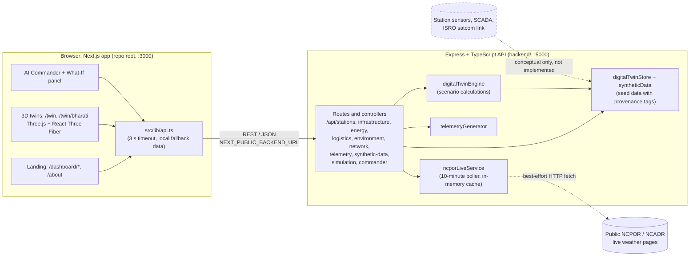

# Himdrishti: Digital Twin for India's Antarctic Research Stations

> An interactive digital twin of India's **Bharati** and **Maitri** Antarctic research stations. It combines a 3D station model, a live-style telemetry dashboard, a what-if crisis simulator and a rule-based "AI Commander" so remote teams can monitor and rehearse operations for infrastructure, energy, logistics and environment.

**Smart India Hackathon (SIH) Problem Statement ID:** `26060`

---

## Table of Contents

1. [Overview and Objectives](#overview-and-objectives)
2. [Core Capabilities and Implementation Status](#core-capabilities-and-implementation-status)
3. [Architecture](#architecture)
4. [Tech Stack](#tech-stack)
5. [Getting Started](#getting-started)
6. [Environment Configuration](#environment-configuration)
7. [Available Scripts](#available-scripts)
8. [Repository Structure](#repository-structure)
9. [Documentation and Guides](#documentation-and-guides)
10. [Known Limitations](#known-limitations)
11. [Troubleshooting](#troubleshooting)
12. [Contributing](#contributing)
13. [Team and Credits](#team-and-credits)
14. [License](#license)

---

## Overview and Objectives

India operates two permanent Antarctic research stations: **Bharati** (Larsemann Hills) and **Maitri** (Schirmacher Oasis). Operating them means managing power generation, fuel and supply logistics, water and infrastructure, harsh weather and a constrained satellite link, often from thousands of kilometres away.

Himdrishti is a prototype that answers the SIH problem statement of building a digital twin framework for Maitri and Bharati that integrates infrastructure, energy, logistics and environmental monitoring for efficient remote management.

**Objectives**

- Give remote operators one place to see the state of each station across infrastructure, energy, logistics, environment and communications.
- Provide an explorable 3D model of each station with room-level telemetry cards.
- Let operators rehearse crisis scenarios (storms, generator trips, supply delays, comms loss) and see projected impacts before they happen.
- Make the origin of every data point explicit through provenance tags (official, documentary, assumption, inference, live sensor or simulated).

> **Prototype notice:** most station data in this repository is seed or synthetic data modelled on public and documentary sources. Only the weather feed has a code path that attempts to read a live public source (see [Known Limitations](#known-limitations)). This project is not connected to any NCPOR internal system.

---

## Core Capabilities and Implementation Status

| Capability | What exists in this repository | Status |
| :--- | :--- | :--- |
| **Real-time telemetry** | Express endpoints for telemetry, energy, logistics, environment, infrastructure and network (`/api/telemetry`, `/api/energy`, ...). The dashboard and 3D HUD fetch from them. Telemetry values and log ticks come from seed data and a generator. A background poller tries to fetch public NCPOR/NCAOR live weather pages every 10 minutes and caches the result. | **Implemented (prototype data).** Weather live feed is best-effort and was not verified against the live sites for this README. |
| **3D digital twin** | Interactive Three.js / React Three Fiber models of **Bharati** (`/twin/bharati`) and **Maitri** (`/twin`), with GLB assets in `public/assets/`, room navigation, room-anchored telemetry cards and lifeline flow visuals. | **Implemented.** |
| **What-if simulation** | `POST /api/simulation` runs five formula-based scenarios (`EXTREME_WEATHER`, `GENERATOR_FAILURE`, `INCREASED_ENERGY_DEMAND`, `SUPPLY_DELAY`, `COMMUNICATION_OUTAGE`) and returns baseline vs. projected KPIs, alerts and recommended actions. Used by the 3D twin simulator panel and the `/dashboard/simulations` page. | **Implemented** (simplified model, not a validated physics simulation). |
| **AI Commander** | A chat-style console in the 3D twin that calls `POST /api/commander/query`. The backend matches keywords in the question, answers from current station data and can trigger actions in the 3D scene (fly to a room, start a simulation, toggle a blizzard). | **Implemented as a rule-based assistant.** No external LLM or AI service integration exists in the code. |
| **Direct NCPOR / station-sensor integration** | None. Station sensors, SCADA and the ISRO satellite store-and-forward link are modelled in software only. | **Conceptual / not implemented.** |

---

## Architecture



**Data flow in short**

1. The Next.js frontend calls the Express API through `src/lib/api.ts`.
2. Controllers read seed data from `backend/src/store/`, generated telemetry, scenario results from `digitalTwinEngine`, and the cached live weather feed when available.
3. If the backend is unreachable or slow, the frontend falls back to local constants and surfaces that state with a "mock data" badge instead of failing.
4. Dashed elements are external or conceptual. The NCPOR fetch is an attempt to read public web pages; nothing else external is integrated.

---

## Tech Stack

Versions below are read from `package.json` (frontend, repo root) and `backend/package.json`.

| Layer | Technology | Version in manifest |
| :--- | :--- | :--- |
| Frontend framework | Next.js (App Router) | `16.3.6` (pinned) |
| UI library | React / React DOM | `19.2.8` (pinned) |
| 3D | Three.js, `@react-three/fiber`, `@react-three/drei` | `^0.186.1`, `^9.8.1`, `^10.7.9` |
| Styling and motion | Tailwind CSS, Framer Motion, GSAP | `^4`, `^13.4.4`, `^3.15.0` |
| Backend | Express | `^4.21.2` (Express **4**, not 5) |
| Backend tooling | `ts-node-dev`, `tsc`, `cors`, `dotenv` | see `backend/package.json` |
| Language | TypeScript (strict mode in both packages) | `^5` / `^5.7.3` |
| Runtime | Node.js | `>=20.0.0 <21.0.0` (`engines` and `.nvmrc`) |
| Package manager | **npm** | `package-lock.json` at the root and in `backend/` |

Notes on discrepancies:

- The backend is Express **4.x**. Anything that assumes Express 5 behaviour does not apply here.
- Both packages require **Node 20.x**. Other major versions print `EBADENGINE` warnings and are unsupported.
- There is no separate `frontend/` folder: the Next.js app lives at the repository root (its `package.json` name is `frontend`).

---

## Getting Started

### Prerequisites

- **Node.js 20.x** (use [nvm](https://github.com/nvm-sh/nvm): `nvm install && nvm use` reads `.nvmrc`)
- **npm** (bundled with Node 20)
- A browser with **WebGL** support for the 3D twins
- Git

### 1. Clone

```bash
git clone https://github.com/Intell-Alpha/Antarctica_Digital_twin.git
cd Antarctica_Digital_twin
nvm use
```

### 2. Backend (`backend/`, port 5000)

Run from the repository root:

```bash
npm --prefix backend ci
cp backend/.env.example backend/.env
npm run backend:dev
```

The API is then available at <http://localhost:5000>. A health check is `curl http://localhost:5000/`, which returns a JSON object with `"status": "ONLINE"`.

Equivalent commands from inside `backend/`: `npm ci`, then `npm run dev`.

### 3. Frontend (repo root, port 3000)

In a second terminal, from the repository root:

```bash
npm ci
cp .env.example .env.local
npm run dev
```

Open <http://localhost:3000>. The frontend still loads if the backend is not running; it then shows fallback data with a mock-data badge.

> On Windows PowerShell, replace `cp` with `Copy-Item`, for example `Copy-Item .env.example .env.local`.

### Bundler flag: `--no-turbo` vs `--webpack`

Next.js 16 uses Turbopack by default. This project runs the **dev server with webpack**. The flag was introduced in #50 as a workaround for a font bug in development (per that commit's message), and the dev server has used a non-Turbopack bundler since.

- Only the **`dev`** script is affected. In `package.json` it is `next dev --webpack`. `build` and `start` carry no bundler flag.
- An earlier commit used `next dev --no-turbo`. It was replaced by `--webpack`, which is the documented opt-out in Next.js 16 ([Next.js Turbopack docs](https://nextjs.org/docs/app/api-reference/turbopack)). If you see `--no-turbo` in an old PR or note, it is outdated.
- Start the server with **`npm run dev`**. Do not append `--webpack` or `--no-turbo` yourself; the flag is already in the script.
- If you must call Next directly (for example `npx next dev`), pass `--webpack` once and only once.
- Extra arguments go after `--`, for example `npm run dev -- --port 3001`.

### Production build

```bash
npm run build && npm start                  # frontend
npm run backend:build && npm run backend:start   # backend (compiles to backend/dist)
```

---

## Environment Configuration

Example files are committed; real `.env` files are git-ignored. Create your local files by copying the examples and never commit them.

| Example file | Copy to | Purpose |
| :--- | :--- | :--- |
| [`.env.example`](.env.example) | `.env.local` (repo root) | Frontend settings |
| [`backend/.env.example`](backend/.env.example) | `backend/.env` | Backend settings |

**Frontend (`.env.example`)**

| Variable | Default | Notes |
| :--- | :--- | :--- |
| `NEXT_PUBLIC_BACKEND_URL` | `http://localhost:5000` | Base URL of the Express API. Variables prefixed `NEXT_PUBLIC_` are embedded in the browser bundle, so never put secrets here. Restart `npm run dev` after changing it. |

**Backend (`backend/.env.example`)**

| Variable | Example value | Notes |
| :--- | :--- | :--- |
| `PORT` | `5000` | Used by `backend/src/config/env.ts`. |
| `NODE_ENV` | `development` | Read in `env.ts`. |
| `CORS_ORIGIN` | `http://localhost:3000` | Used by `env.ts`. If unset it defaults to `*` (any origin), so set it explicitly for any shared deployment. |
| `NCPOR_BASE_URL` | `https://ncpor.example.gov.in/api` | **Placeholder.** Listed in the example file but not read by any backend source file today. |
| `POLLER_ENABLED` | `true` | **Not read by any backend source file today.** The live-data poller always starts with the server (10-minute interval, hard-coded in `backend/src/index.ts`). |

No credentials or API keys are required to run the project locally.

---

## Available Scripts

| Where | Command | What it does |
| :--- | :--- | :--- |
| Root | `npm run dev` | Next.js dev server with webpack on port 3000 |
| Root | `npm run build` / `npm start` | Production build / serve |
| Root | `npm run lint` | ESLint (flat config, Next.js rules) |
| Root | `npm run backend:dev` / `backend:build` / `backend:start` | Shortcuts that run the matching `backend/` script via `npm --prefix backend` |
| `backend/` | `npm run dev` | `ts-node-dev` with auto-restart on port 5000 |
| `backend/` | `npm run build` / `npm start` | Compile to `backend/dist` / run the compiled server |

There is no automated test runner configured yet, and no CI workflow for `backend/`. The frontend CI ([`.github/workflows/frontend-ci.yml`](.github/workflows/frontend-ci.yml)) runs `npm ci`, `npm run lint` (non-blocking) and `npm run build`, and only for changes under `src/`, `public/` and a few config files, so Markdown-only changes do not trigger it.

---

## Repository Structure

```text
.
├── src/                    # Next.js app (App Router)
│   ├── app/                # Routes: /, /about, /dashboard/*, /twin, /twin/bharati, /bharati
│   ├── components/         # UI, 3D twins (BharatiStationTwin, MaitriStationTwin), AI Commander, dashboard, landing
│   ├── context/            # Theme context
│   ├── hooks/              # Shared hooks
│   └── lib/                # api.ts (backend client + fallback), telemetry constants, utilities
├── public/                 # Static files; assets/ holds the Bharati and Maitri GLB models, draco/ the decoders
├── backend/                # Express + TypeScript API and simulation engine
│   └── src/                # config/, routes/, controllers/, services/, store/
├── .github/                # Issue and PR templates, frontend CI workflow
├── .agents/                # AI-agent skill files used by contributors' tooling (not part of the app)
├── CONTRIBUTING.md         # Branching, commits, PR workflow, CI notes
├── *_GUIDE.md, *.md        # Integration and asset guides (see below)
├── package.json            # Frontend manifest (npm; lockfile: package-lock.json)
└── .env.example            # Frontend environment template
```

---

## Documentation and Guides

| Document | What it covers |
| :--- | :--- |
| [`backend/README.md`](backend/README.md) | Backend architecture, provenance model, REST endpoints with sample requests, scenario formulas |
| [`BHARATI_DIGITAL_TWIN_INTEGRATION_GUIDE.md`](BHARATI_DIGITAL_TWIN_INTEGRATION_GUIDE.md) | Integrating the Bharati 3D twin: assets, loaders, room registry, camera transitions |
| [`maitri_asset_guide.md`](maitri_asset_guide.md) | Maitri 3D asset, utility pipeline and animation reference |
| [`DIGITAL_TWIN_REMOTE_MANAGEMENT.md`](DIGITAL_TWIN_REMOTE_MANAGEMENT.md) | Remote-management framework: room telemetry cards, what-if simulator, vitals bar |
| [`FRONTEND_ISSUES.md`](FRONTEND_ISSUES.md) | Snapshot of known frontend issues (some items may already be fixed) |
| [`CONTRIBUTING.md`](CONTRIBUTING.md) | Contribution workflow |

Some of these guides were written during development and contain absolute local Windows paths (for example `C:\...`); treat those as examples, not repository paths. The backend README does not yet list `POST /api/commander/query` or `/api/environment/sync`; the route files in `backend/src/routes/` are the source of truth.

---

## Known Limitations

- **Mostly simulated data.** Infrastructure, energy, logistics and network values are seed or generated data, tagged with provenance labels. Do not treat them as real station readings.
- **Live weather is best-effort.** `backend/src/services/ncporLiveService.ts` fetches and parses public pages from hard-coded NCPOR/NCAOR URLs. The page format or availability can change. The service also passes an HTTPS agent configured with `rejectUnauthorized: false` (to tolerate a certificate-hostname mismatch), which is intended to relax TLS certificate checks for those requests. Review this before any production use.
- **AI Commander is rule-based.** It answers by keyword matching, not by a language model.
- **Simplified simulation.** Scenarios use linear formulas documented in `backend/README.md`.
- **Unused backend variables.** `NCPOR_BASE_URL` and `POLLER_ENABLED` are present in `backend/.env.example` but have no effect yet.
- **Large 3D assets.** `public/assets/` is roughly 66 MB, which makes the first clone and first 3D page load heavy.
- **No tests, and no backend CI** at present.

---

## Troubleshooting

| Problem | Things to check |
| :--- | :--- |
| `EBADENGINE` warnings or odd install errors | You are not on Node 20.x. Run `nvm use` in the repository root. |
| Dashboard shows a mock-data badge | The backend is not running or not reachable at `NEXT_PUBLIC_BACKEND_URL`. Start it with `npm run backend:dev` and check `curl http://localhost:5000/`. |
| Browser CORS errors | Set `CORS_ORIGIN` in `backend/.env` to the exact frontend origin (for example `http://localhost:3000`) and restart the backend. |
| Changed `NEXT_PUBLIC_BACKEND_URL` but nothing happened | Restart `npm run dev`; public variables are read at build/start time. |
| `EADDRINUSE` on port 3000 or 5000 | Another process is using the port. Stop it, or use `npm run dev -- --port 3001` and/or change `PORT` in `backend/.env` (and update `NEXT_PUBLIC_BACKEND_URL` to match). |
| Font or dev-server oddities | Make sure you ran `npm run dev` (webpack), not a bare `next dev` (Turbopack). See [Bundler flag](#bundler-flag---no-turbo-vs---webpack). |
| Blank or slow 3D view | Confirm WebGL is enabled in the browser and wait for the GLB models to load; the first load downloads large assets. |
| No live weather values | The public NCPOR/NCAOR pages may be unreachable from your network. The backend then serves its cached or seed values. |

---

## Contributing

Contributions are welcome. Read [`CONTRIBUTING.md`](CONTRIBUTING.md) for branch naming (`feat/`, `fix/`, `docs/`, ...), Conventional Commit messages, the pull request workflow and CI notes. Use the templates in [`.github/`](.github) for issues and pull requests. Before opening a PR that changes application code, run `npm run lint` and `npm run build` locally.

---

## Team and Credits

**Team name:** _To be confirmed by the maintainers. No team name appears in the repository._

The repository does not contain an official member list. The following are the **commit authors in the git history** (alphabetical by display name); roles and affiliations are not recorded and should be confirmed before the README is finalised for SIH submission:

- Abdul Faatih Siddiqui (also appears as `Abfa41`)
- adithya3010
- Mansoor Khan
- MD Khaja Rehan
- Vishnu / Vishnu Vardhan

Third-party assets: Draco decoders in `public/draco/` are from Google Draco (Apache License 2.0).

---

## License

**No license has been specified for this project.** The repository has no top-level `LICENSE` file, and `package.json` declares no `license` field. Until the maintainers choose one, do not assume the code may be reused or redistributed.

Bundled third-party components keep their own licenses, for example the Draco decoders in [`public/draco/`](public/draco/README.md) (Apache 2.0).